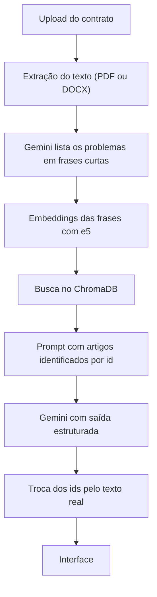

# ContratosCheck

## Sobre o Projeto
O **ContratosCheck** é um sistema web em que o usuário envia um contrato em PDF ou DOCX e recebe os pontos de atenção encontrados no documento, com a gravidade, a explicação do risco e o fundamento legal de cada um.

A análise usa **RAG** (geração aumentada por recuperação): o **Gemini** resume cada problema do contrato em uma frase curta, o sistema usa essas frases para buscar os artigos de lei mais próximos em uma base vetorial, e o Gemini só pode fundamentar a resposta nos artigos encontrados. A base é montada a partir do repositório [ctresb/leis](https://github.com/ctresb/leis) e contém a Constituição Federal, o Código Civil, o Código de Defesa do Consumidor, a Lei do Inquilinato, a CLT, a LGPD, a Lei de Arbitragem e o Código de Processo Civil.

---

## Problema
Pessoas sem formação jurídica assinam contratos de aluguel, de prestação de serviço e de trabalho sem saber se as cláusulas respeitam a lei. Esses contratos podem trazer cláusulas abusivas, escritas em linguagem difícil, e pagar um advogado para revisar cada documento costuma ser caro demais para o dia a dia.

O ContratosCheck entrega uma primeira leitura: aponta as cláusulas que merecem atenção, explica o risco em linguagem simples, indica a gravidade e mostra em quais artigos de lei o ponto se apoia.

---

## Abordagem

### Por que RAG
Um modelo de linguagem respondendo de memória pode citar um artigo errado ou inexistente, o que é grave em um assunto jurídico. Com **RAG**, a análise parte de trechos reais da legislação, recuperados da base. Além disso, o modelo não escreve a citação: ele só indica ids como `N7`, e o sistema troca cada id pelos dados do trecho original. Ids que não existem na busca são descartados.

### Por que buscar pelo problema
O texto de um contrato não fala como a lei: ele traz nomes, valores e uma redação própria, e por isso a busca direta deixava artigos importantes de fora. Por isso, o Gemini primeiro resume cada problema em uma frase curta, como "vedação a mais de uma modalidade de garantia na locação", e a busca usa essas frases. Em contratos com problemas, isso exige duas chamadas ao Gemini em vez de uma.

### Por que só 8 normas
O repositório [ctresb/leis](https://github.com/ctresb/leis) tem cerca de 324 mil normas, e a maioria não trata de contratos. Por isso, a base usa apenas as 8 normas federais mais ligadas ao tema, o que mantém a vetorização viável em uma máquina comum e evita resultados de leis sem relação com o documento.

### Por que commit fixo
As normas são baixadas de um commit específico do repositório, e não da branch principal. Assim, o texto vetorizado é sempre o mesmo, a ingestão pode ser reproduzida e a base não muda sem que isso seja uma decisão do projeto.

---

## Funcionalidades
- Envio de contratos em PDF ou DOCX pela interface web
- Busca automática dos artigos de lei relacionados ao contrato
- Lista de pontos de atenção com trecho da cláusula, explicação, gravidade e fundamento legal
- Ingestão automática das normas na primeira inicialização, ignorada quando a base já existe
- Limites de uso: arquivos de até 10 MB, PDFs de até 100 páginas, textos de até 200 mil caracteres e 50 análises por dia

---

## Tecnologias Utilizadas
* **Front-end:** React, TypeScript, Vite, Tailwind CSS
* **Back-end:** Python, FastAPI, Uvicorn, pypdf, python-docx
* **Banco de dados:** ChromaDB (base vetorial)
* **IA:** LangChain, Gemini API (`gemini-3.5-flash-lite`), Sentence Transformers (`intfloat/multilingual-e5-base`)
* **Conteinerização:** Docker, Docker Compose

---

## Arquitetura

### Fluxo da análise


### Camadas
- **controller:** recebe o upload, valida a extensão e o tamanho do arquivo e transforma os erros do sistema em respostas HTTP.
- **service:** extrai o texto, pede ao Gemini a lista de problemas, busca as normas de cada problema, numera os trechos com ids, chama o agente, troca os ids pelos dados reais e ordena os pontos por gravidade. Se nenhum problema for listado, responde sem a segunda chamada.
- **rag:** baixa as normas, divide o texto, gera os embeddings e grava tudo no ChromaDB.
- **IA:** configura o Gemini, os dois prompts e o formato das respostas.

### Ingestão das normas
As 8 normas são lidas linha por linha e divididas por artigo, o que mantém cada trecho com um sentido jurídico próprio. Cada trecho guarda a norma, o artigo, a hierarquia de títulos e a fonte. A hierarquia diferencia artigos com o mesmo número, como os da Constituição e os do ADCT.

Artigos que só informam que foram revogados ou vetados são descartados, assim como assinaturas e textos anteriores ao primeiro artigo. Artigos longos são divididos em partes de cerca de 1.100 caracteres, abaixo do limite de 512 tokens do modelo de embedding, e as partes seguintes recebem a marcação `(continuação)`. Ao final, a base tem 5.753 trechos.

---

## Instalação e Configuração

### 1. Pré-requisitos
- [Git](https://git-scm.com/)
- [Docker](https://www.docker.com/), para rodar com Docker
- [Python 3.12 ou superior](https://www.python.org/) e [Node.js 24](https://nodejs.org/), para rodar sem Docker
- Uma chave da Gemini API, criada no [Google AI Studio](https://aistudio.google.com/)

### 2. Clonar o repositório
```bash
git clone https://github.com/PedroLovatto99/IA_G2_contratos.git
cd IA_G2_contratos
```

### 3. Configurar variáveis de ambiente (.env)
Copie o arquivo `.env.example` para `.env`, na raiz do projeto, e preencha a chave:

```env
# Chave da Gemini API, obrigatória para o back-end iniciar
GEMINI_API_KEY=sua_chave_aqui
```

**IMPORTANTE:** o texto dos contratos enviados é processado pela Gemini API. Não use contratos com dados pessoais reais em testes.

Para apontar o front-end para outra API, defina `VITE_API_URL` em `frontend/.env`. Sem essa variável, ele usa `http://localhost:8000`.

### 4. Rodar com Docker (Recomendado)
```bash
docker compose up --build
```

**IMPORTANTE:** a primeira inicialização é demorada, pois baixa o modelo de embedding (cerca de 1 GB) e vetoriza as normas na CPU, o que pode levar dezenas de minutos. A API só responde quando o log mostrar `Uvicorn running`. Nas próximas vezes, a base e o modelo são reaproveitados dos volumes do Docker.

O comando `docker compose down -v` apaga esses volumes e faz a ingestão rodar de novo.

### 5. Rodar sem Docker

**Back-end**, a partir da raiz do projeto:

```bash
cd backend
python -m venv env
```

Ative o ambiente virtual:

```bash
# Windows
env\Scripts\activate

# Linux e macOS
source env/bin/activate
```

Instale as dependências, gere a base de normas e inicie a API:

```bash
pip install -r requirements.txt
python -m rag.ingestao_dados
uvicorn app:app --port 8000
```

**Front-end**, em outro terminal, a partir da raiz do projeto:

```bash
cd frontend
npm install
npm run dev
```

**IMPORTANTE:** a base gerada sem Docker fica em `backend/rag/chromadb/` e é separada da base do volume do Docker, por isso a ingestão precisa ser feita uma vez em cada ambiente.

---

## Como Acessar
```bash
http://localhost:5173
```

Selecione um contrato em PDF ou DOCX e clique em **Analisar contrato**.

A documentação interativa da API fica em:

```bash
http://localhost:8000/docs
```

---

## Estrutura de Diretórios
```text
.
├── docker-compose.yml             # Orquestração: backend e frontend, com volumes da base e do modelo
├── .dockerignore                  # Arquivos fora da imagem do backend
├── .env.example                   # Variáveis de ambiente exigidas (copiar para .env)
├── exemplos/                      # Contratos fictícios em DOCX para testes
├── backend/                       # Python + FastAPI
│   ├── app.py                     # Criação da aplicação e configuração de CORS
│   ├── Dockerfile                 # Imagem do backend com PyTorch para CPU
│   ├── requirements.txt           # Dependências Python
│   ├── controller/
│   │   └── rotas.py               # Endpoints da API e validação do upload
│   ├── service/
│   │   └── contratoService.py     # Leitura do arquivo, busca das normas e regras de uso
│   ├── rag/
│   │   └── ingestao_dados.py      # Download, divisão por artigo e vetorização das normas
│   └── IA/
│       └── agente_config.py       # Modelo Gemini, os dois prompts e o formato das respostas
└── frontend/                      # React + TypeScript + Vite
    ├── Dockerfile                 # Imagem do servidor de desenvolvimento do Vite
    ├── package.json               # Dependências e scripts
    ├── vite.config.ts             # Configuração do Vite e do Tailwind CSS
    └── src/
        ├── App.tsx                # Tela de envio do contrato e de resultado
        ├── index.css              # Importação do Tailwind CSS
        └── main.tsx               # Ponto de entrada do React
```

---

## Limitações e Próximos Passos

### Limitações
- **Base restrita:** apenas 8 normas federais são consultadas. Leis estaduais, municipais e outras normas federais ficam de fora.
- **Sem OCR:** PDFs escaneados não são aceitos, e páginas que são apenas imagem não são lidas.
- **Dependência da API do Gemini:** a análise exige conexão e está sujeita às cotas da API, com até duas chamadas por contrato.
- **Problemas não listados:** a busca depende da primeira chamada ao Gemini, então um problema que ela deixe passar pode ficar sem fundamento ou não ser apontado.
- **Privacidade:** o texto do contrato é enviado ao Google, então o sistema não é indicado para documentos sigilosos.

### Próximos passos
- Usar um LLM local, para que os contratos não saiam da máquina
- Ampliar a base com mais normas
- Incluir jurisprudência e súmulas
- Guardar o histórico de análises

---

## Aviso Legal
O ContratosCheck é um projeto acadêmico. O resultado é um apoio informativo para a leitura do contrato e não substitui a orientação de um advogado. A análise é gerada por inteligência artificial e pode conter erros ou omissões.
